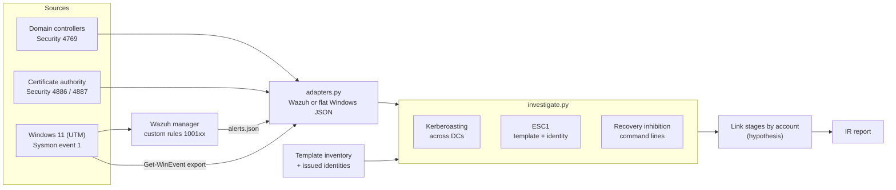

# Ransomware precursor investigation

Detects and links three steps that often come before ransomware, from Windows event logs:
Kerberoasting, certificate abuse through a misconfigured AD CS template (ESC1), and deletion
of shadow copies and backups. The output is a set of findings plus an analyst hypothesis that
links them, written up as a full [incident report](IR-report.md).

Runs on macOS with Python 3.10+ (standard library only). Endpoint telemetry comes from a
Windows 11 VM in UTM with Sysmon and the Wazuh agent.

## What is real and what is synthetic

| Stage | Data | Status |
| --- | --- | --- |
| Kerberoasting (4769) | Synthetic exercise in real Windows field format | Real DC telemetry pending, see [docs/LAB.md](docs/LAB.md) |
| AD CS ESC1 (4886/4887) | Synthetic exercise in real Windows field format | Real CA telemetry pending |
| Shadow copy / backup deletion (Sysmon 1) | Synthetic exercise; one real benign control from the UTM VM | Deletion detections verified against recorded exercise events |
| Wazuh alerting | Custom rules in [wazuh/local_rules.xml](wazuh/local_rules.xml) | Not yet loaded on the manager |

The local lab uses recorded domain and CA evidence. See [the lab guide](docs/LAB.md).

## How it works



## Detections

| Detection | Logic | ATT&CK | Severity |
| --- | --- | --- | --- |
| Kerberoasting-like burst | One requester and source IP gets successful tickets for 4+ distinct user service accounts in 5 min, combined across all DCs. Machine accounts (`$`) and `krbtgt` excluded. | T1558.003 | High with RC4 tickets, Medium if AES only |
| ESC1-like issuance | 4887 from a template with broad enrollment, requester-supplied subject, an authentication EKU and no approval, where the issued identity differs from the requester | T1649 | High |
| Risky template issuance | Same template, issued identity not yet verified | T1649 | Medium |
| Recovery inhibition | Command lines for `vssadmin delete shadows` / `resize shadowstorage`, `wmic shadowcopy delete`, PowerShell `Win32_ShadowCopy` delete, `wbadmin delete catalog/systemstatebackup/backup`, `bcdedit recoveryenabled no` | T1490 | High |

**Linking:** findings from different stages that share an account (the ticket requester, the
certificate requester or issued identity, or the process user) within 2 hours are grouped as an
*unconfirmed* same-actor hypothesis, with the evidence needed to confirm it.

**Known limits:**
- The Kerberoasting rule can be evaded with slow requests (more than 5 minutes apart), requests
  from many source IPs, or targeting fewer than 4 services.
- A 4887 event does not contain the identity in the certificate's SAN. The issued identity comes
  from decoding the certificate (`certutil -view`, then `certutil -dump`), recorded in
  [evidence/issued.json](evidence/issued.json). The detector reports `san:upn=` as the requested identity pending certificate verification.
- Process starts show intent, not impact. Backup console logs and a restore test show loss.

## Run it

```sh
python3 investigate.py                                  # synthetic exercise
python3 investigate.py evidence/lab-endpoint.jsonl      # your VM export
python3 investigate.py /path/to/alerts.json             # Wazuh manager alerts
python3 -m unittest -v
```

Input is auto-detected per line: Wazuh `alerts.json` rows, Get-WinEvent JSON exports, or
public recorded datasets with flat Windows fields (for example OTRF Security-Datasets).
Lines that can't be parsed are counted and skipped.

The [saved findings](evidence/findings.json) are what the synthetic exercise produces; a test
checks they reproduce, including with duplicated and reordered events.

## Layout

```
investigate.py      detections and stage linking
adapters.py         Wazuh / flat Windows JSON -> normalized events
evidence/           exercise events, template inventory, issued identities, saved findings, live control
wazuh/              custom Wazuh rules
docs/LAB.md         collecting real telemetry on an Apple Silicon Mac
IR-report.md        incident report for the exercise
```
